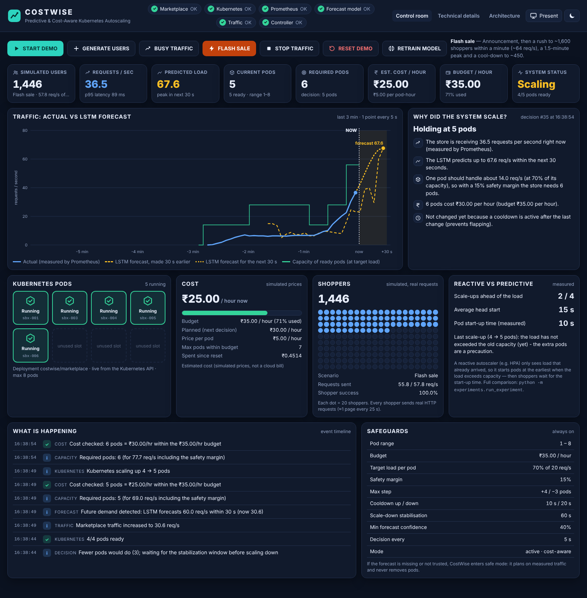

# COSTWISE — Predictive & Cost-Aware Kubernetes Autoscaling

[](https://github.com/unaidabdullah-ui/costwise-predictive-kubernetes-autoscaler/actions/workflows/ci.yml)
[](pyproject.toml)
[](LICENSE)



### Results at a glance (flash-sale scenario, simulation)

| | Fixed pods (peak) | Kubernetes HPA | **CostWise** |
|---|---|---|---|
| SLA violations | 0 % | 28.5 % | **0 %** |
| p95 latency | 57 ms | 5,500 ms | **71 ms** |
| Estimated cost | 5.00 | 3.13 | **2.78** (−44 % vs fixed) |

Same controller code, simulated cluster: [full results and caveats](docs/experiments.md).

**Tech:** Python · NumPy LSTM · Kubernetes · Prometheus · Grafana · Starlette · Docker · Minikube · pytest · GitHub Actions

---

CostWise autoscales a real web application on Kubernetes **before** traffic arrives.
An LSTM forecasts the next 30 seconds of traffic, a cost optimiser picks the cheapest
number of pods that can serve it within a budget, and a safety policy applies the
change to Kubernetes. The whole demo runs on a 4 GB Windows 11 laptop with Minikube,
and is controlled from one dashboard with big buttons (START DEMO, FLASH SALE, …).

> Version 2.1.0 · Python 3.10+ · Minikube (Docker driver) · MIT licence

---

## Contents

1. [What it does (in one minute)](#1-what-it-does-in-one-minute)
2. [What you see in the demo](#2-what-you-see-in-the-demo)
3. [Architecture](#3-architecture)
4. [Repository layout](#4-repository-layout)
5. [Requirements](#5-requirements)
6. [Installation on Windows 11](#6-installation-on-windows-11)
7. [Running the demo (one click)](#7-running-the-demo-one-click)
8. [The control-room dashboard](#8-the-control-room-dashboard)
9. [The COSTWISE MARKETPLACE application](#9-the-costwise-marketplace-application)
10. [The forecasting model (LSTM) and RETRAIN MODEL](#10-the-forecasting-model-lstm-and-retrain-model)
11. [Cost-aware optimisation](#11-cost-aware-optimisation)
12. [Safeguards and safe mode](#12-safeguards-and-safe-mode)
13. [Security](#13-security)
14. [API reference](#14-api-reference)
15. [Configuration](#15-configuration)
16. [Experiments: fixed vs HPA vs predictive vs cost-aware](#16-experiments-fixed-vs-hpa-vs-predictive-vs-cost-aware)
17. [Testing — what was and was not tested](#17-testing--what-was-and-was-not-tested)
18. [Troubleshooting, limitations and further reading](#18-troubleshooting-limitations-and-further-reading)

---

## 1. What it does (in one minute)

* **The application**: *COSTWISE MARKETPLACE*, an original online store (48 products,
  search, cart, checkout simulation) running as a Kubernetes Deployment of 1–8 pods.
* **The traffic**: a traffic generator simulates shoppers who send *real* HTTP
  requests (browse, search, product pages, cart, checkout). Scenarios: normal, busy,
  flash sale, burst, recovery.
* **The measurements**: Prometheus scrapes every pod every 5 s (requests/second,
  latency, errors, CPU).
* **The brain**: every 5 s CostWise
  1. reads the last 60 s of traffic from Prometheus,
  2. forecasts the next 30 s with an LSTM,
  3. converts the forecast into *required pods* (one pod ≈ 20 req/s, planned at 70 % + 15 % margin),
  4. picks the cheapest pod count that covers it within the budget (₹ per hour, simulated prices),
  5. applies cooldowns/step limits, and
  6. patches `deployments/scale` in Kubernetes — the only write permission it has.
* **Why**: a reactive autoscaler (the Kubernetes HPA) starts pods *after* CPU is
  already high; pods take seconds to become ready, so shoppers feel the flash sale.
  CostWise starts them before the rush and removes them afterwards to save cost.

## 2. What you see in the demo

| Step | Button | What happens (all live data) |
|---|---|---|
| 1 | **START DEMO** | ~170 shoppers browse the store (~7 req/s). 1 pod. |
| 2 | **FLASH SALE** | Shoppers rush to ~1,600 (~64 req/s) within a minute. The orange LSTM forecast rises **before** the blue measured line; pods go 1 → 6 ahead of the load. |
| 3 | *watch* | "Why did the system scale?" explains each decision in plain English with the real numbers; the cost bar stays under the ₹35/h budget. |
| 4 | **STOP TRAFFIC** | Traffic falls to zero; after the stabilisation window the pods are removed again and the cost drops. |
| 5 | **RESET DEMO** | Clean slate for the next presentation. |

Other buttons: **GENERATE USERS** (+300 shoppers), **BUSY TRAFFIC** (gradual rise to
~900 shoppers), **RETRAIN MODEL** (really retrains the LSTM, see §10). Press **P** for
presentation mode (large fonts for a projector), **F** for full screen.
The step-by-step talk track is in [docs/DEMO_SCRIPT.md](docs/DEMO_SCRIPT.md).

Screenshots of the control room from the validation run are in
[docs/screenshots/](docs/screenshots/) (taken in the sandbox described in §17).

## 3. Architecture

```
 ┌──────────────── Minikube · namespace costwise ───────────────┐     ┌──────── your laptop ────────────────────────┐
 │                                                              │     │  python -m costwise  (127.0.0.1:8000)        │
 │  traffic-generator ──HTTP──► Service marketplace ──► pods 1..8│     │   collector ─► LSTM ─► capacity planner      │
 │        ▲                                   │ /metrics        │     │      ▲                       │               │
 │        │ control API (token)                ▼                 │     │      │              cost optimiser ─► policy │
 │        │                             Prometheus (5 s scrape) ─┼─────┼──────┘                               │      │
 │        │                                                     │ ◄───┼── patch deployments/scale (RBAC Role) ◄──┘      │
 └────────┼─────────────────────────────────────────────────────┘     │  dashboard (browser) — fixed demo actions only │
          └───────────────────────── port-forward 8089 ◄───────────────┤                                                │
                                                                       └────────────────────────────────────────────────┘
```

The control plane runs on the laptop (not in the cluster) to keep Minikube small on
a 4 GB machine; it reaches the cluster with a 12-hour token of a least-privilege
ServiceAccount and reaches Prometheus/the traffic generator/the store through
supervised `kubectl port-forward`s. Details: [ARCHITECTURE.md](ARCHITECTURE.md).

## 4. Repository layout

```
start-demo.ps1 / stop-demo.ps1 / reset-demo.ps1   one-click scripts (Windows; .sh versions for Linux/macOS/WSL)
costwise/            control plane: runtime, web server, dashboard (static/), explanations, health
autoscaler/          the engine: config, Prometheus client, capacity planner, cost model + optimiser,
                     scaling policy, Kubernetes client, controller loop, events, metrics
marketplace/         COSTWISE MARKETPLACE (Starlette app, catalogue, storefront UI)
workload_generator/  simulated shoppers (plans, traffic engine, control API)
ml/src/              LSTM: NumPy implementation (lite.py, numpy_lstm.py — used by the demo) and the
                     optional PyTorch pipeline (train.py, model.py …); ml/models/lstm_lite.npz = shipped model
simulator/, experiments/   offline experiments (fixed / HPA / predictive / cost-aware) and live harness
kubernetes/          manifests (namespace, RBAC, marketplace, generator, monitoring/, optional/, experiments/)
prometheus/          scrape config + alert/recording rules        grafana/   optional dashboard
docker/              Dockerfiles                                   tests/     pytest suite
docs/                methodology, ML, cost model, Kubernetes, experiments, testing, troubleshooting, report outline
```

## 5. Requirements

| | Minimum | Notes |
|---|---|---|
| OS | Windows 11 (PowerShell 5.1 or 7) | Linux/macOS/WSL work with the `.sh` scripts. WSL is **not** required. |
| RAM | 4 GB | Minikube gets 2.2 GB; Grafana is optional (off by default). Close heavy apps. |
| CPU | 2 cores | |
| Software | Docker Desktop, Minikube ≥ 1.30, kubectl, Python 3.10–3.12 | |
| GPU | not needed | An RTX 3070 (or any GPU) is only used by the optional PyTorch pipeline. |
| Internet | first run only | to download Docker images and pip packages; the store itself has no internet dependency. |

Memory budget (approx.): Minikube system ≈ 1.1 GB, marketplace pods 40–60 MB each,
traffic generator ≈ 60 MB, Prometheus 150–250 MB, control plane on the host ≈ 120 MB.

## 6. Installation on Windows 11

1. Install **Docker Desktop** (WSL2 backend is fine; you never have to open WSL) and start it.
2. Install **Minikube** and **kubectl**, e.g. `winget install Kubernetes.minikube Kubernetes.kubectl`.
3. Install **Python 3.11 or 3.12** from python.org (tick *Add to PATH*).
4. Unpack this project, e.g. to `U:\cost-aware-k8s-autoscaler`.
5. Allow local scripts once (current user only):
   `Set-ExecutionPolicy -Scope CurrentUser RemoteSigned`

`start-demo.ps1` creates `.venv` and installs `requirements/control-plane.txt` itself.

## 7. Running the demo (one click)

```powershell
cd U:\cost-aware-k8s-autoscaler
.\start-demo.ps1            # [1/8] … [8/8], opens http://127.0.0.1:8000
.\stop-demo.ps1             # stop control plane + port-forwards (cluster kept)
.\stop-demo.ps1 -StopCluster   # also `minikube stop` to free RAM (never deletes)
.\reset-demo.ps1            # clean slate before the next presentation
```

`start-demo.ps1` options: `-Cluster <minikube profile>` (default `minikube`),
`-Rebuild` (rebuild the image after code changes), `-WithGrafana`, `-NoBrowser`,
`-MemoryMB 2200 -Cpus 2` (only used when the cluster is created for the first time).
It is safe to run repeatedly: it skips what is already done. It **never deletes**
your Minikube cluster. The eight steps:

1. prerequisites (Docker running, tools present, free RAM)
2. start Minikube if needed
3. Python `.venv` and dependencies
4. build `costwise-marketplace:2.1.0` **inside** Minikube (`minikube image build`, `imagePullPolicy: Never` → no `ErrImagePull`)
5. apply namespace, RBAC, Secret (random token), Prometheus config and Deployments
6. wait for rollouts (with a diagnosis if a pod is not ready)
7. least-privilege kubeconfig (12-hour ServiceAccount token) + supervised port-forwards (they restart automatically when a pod they point at is removed by scale-down)
8. start `python -m costwise` and open the dashboard

Without a cluster you can still explore the UI: `python -m costwise --dry-run`
(clearly labelled "DRY RUN"), or `docker compose up` (store + generator + Prometheus
+ dashboard, dry-run scaler).

## 8. The control-room dashboard

* **Status pills** — Marketplace, Kubernetes, Prometheus, Forecast model, Traffic,
  Controller; each with a symbol *and* a word (OK / Attention / Problem), and a tooltip
  with the reason and the fix.
* **Eight number cards** — simulated users, requests/s, predicted load (next 30 s),
  current pods (ready/desired), required pods, estimated cost ₹/h, budget ₹/h, system status.
* **Main chart** — blue: measured req/s (Prometheus); dashed orange: what the LSTM
  predicted 30 s earlier for that moment; dotted orange: the forecast for the next
  30 s (shaded); green: capacity of the ready pods at the target load; **NOW** marker.
* **Why did the system scale?** — the reasoning of the latest decision with its real numbers.
* **Pods** — one tile per pod (Running / Starting / Stopping) from the Kubernetes API.
* **Cost** — current ₹/h, budget bar, planned cost, pods affordable, accrued cost since reset.
* **Shoppers** — crowd visual (1 dot = 20 shoppers), requests sent, success rate.
* **Reactive vs predictive** — measured head start of each scale-up (see §16).
* **Timeline** — plain-English events (traffic rose, forecast detected a peak, cost
  checked, pods scaled, pods ready, errors and recoveries).
* **Technical details** page — model metrics (MAE/RMSE/MAPE vs naive and Holt), training
  data (synthetic vs real, labelled), every optimiser candidate with its cost and
  objective, live settings form, RBAC/security, Kubernetes events, configuration.
* **Architecture** page — the diagram and the loop explained for non-specialists.

The page polls `/api/dashboard` every 2 s (configurable 1–3 s).

## 9. The COSTWISE MARKETPLACE application

An original store design (no third-party branding, logos or images; product art is
drawn in SVG). Pages: home with deals countdown, categories, product details,
search, deals, cart, simulated checkout, order confirmation, order history.

API (each also without the `/api` prefix): `GET /api/products`, `GET /api/products/{id}`,
`GET /api/search?q=`, `GET /api/categories`, `GET /api/deals`, `GET|POST|DELETE /api/cart`,
`POST /api/checkout`, `GET /api/orders`, plus `/health` and `/metrics`.

Each request performs a fixed amount of real CPU work (e.g. search 14 ms, checkout
20 ms), so a pod limited to 250m CPU saturates at roughly 20–25 req/s and latency
really rises when it is overloaded; above 24 concurrent requests a pod sheds load
with HTTP 503 (counted as errors). The cart lives in a cookie so any pod can serve any
request; orders are kept in memory by the pod that took them (demo).

## 10. The forecasting model (LSTM) and RETRAIN MODEL

* Input: the last **12 steps × 5 s = 60 s** of measured req/s (+ derived features);
  output: the next **6 steps = 30 s**. Architecture `LSTM(32) → Linear → ReLU → Linear(6)`,
  5,990 parameters, implemented in NumPy (`ml/src/numpy_lstm.py`, gradient-checked in
  the tests) so the demo needs no PyTorch and no GPU. An equivalent PyTorch pipeline
  is in `ml/src/train.py` for those who want it.
* **Training data is labelled honestly**: the shipped model was trained only on
  *synthetic bootstrap data* (the same shopper plans the generator uses, measured
  like Prometheus, plus generic patterns). Held-out test error: MAE 2.29, RMSE 4.12,
  MAPE 13.8 % vs naive RMSE 8.44 and Holt RMSE 10.32 req/s (`ml/models/lstm_lite.json`).
* **RETRAIN MODEL** really retrains in a background process on bootstrap data **plus
  the request rates measured by Prometheus during your demos** (`.costwise/history.csv`,
  contiguous segments ≥ 4.5 min), saves the model atomically and hot-reloads it. The
  dashboard shows how many measured samples were used. There is **no continuous or
  online learning**.
* Live accuracy is tracked during the demo (MAE/RMSE of matured forecasts) and turned
  into a **trust score**; below 40 % CostWise switches to safe mode (§12).

More: [docs/ml-model.md](docs/ml-model.md).

## 11. Cost-aware optimisation

For every pod count *r* between MIN and MAX the optimiser evaluates

`J(r) = cost(r) + λ_SLA · E[shortfall(r)] + λ_change · |r − current|`

where `cost(r) = r × ₹5/h` (simulated), the expected shortfall uses the forecast and
its uncertainty (normal model, closed form), λ_SLA = 2 and λ_change = 0.2. Among the pod
counts within the budget that cover the required capacity it picks the minimum of J;
if the budget cannot cover the demand it chooses the best affordable option and
reports **BUDGET LIMIT** / capacity shortfall instead of overspending.
More: [docs/cost-optimization.md](docs/cost-optimization.md).

## 12. Safeguards and safe mode

MIN/MAX pods (1–8) · budget (₹35/h) · step limits (+4/−3 pods) · cooldowns (10 s up,
20 s down) · scale-down stabilisation window (60 s, anti-oscillation) · minimum change ·
forecast trust threshold (40 %) · safety margin (15 %).

**Safe mode** (clearly shown) is entered when the model file is missing/invalid, while
warming up (< 30 s of history), when a forecast is invalid, or when the live trust score
is too low. In safe mode CostWise plans on the *measured* load and never removes pods.
Prometheus down → hold; Kubernetes unreachable → hold; every error is in the timeline.

## 13. Security

* **Least-privilege RBAC** (`kubernetes/rbac.yaml`): a namespace-scoped Role with
  `deployments: get/list/watch`, `deployments/scale: get/patch/update`,
  `pods, events: get/list/watch`. No ClusterRole, no cluster-admin, no access to Secrets.
* The control plane uses a **12-hour ServiceAccount token** written to
  `.costwise/kubeconfig` (user-only permissions), never the Minikube admin credentials.
* The traffic generator's control API requires a random token (Secret
  `costwise-secrets`, created by start-demo, never committed, never shown or logged).
* The dashboard binds to 127.0.0.1, exposes only fixed demo actions (no Kubernetes API
  proxy), requires an `X-CostWise` header and same-origin for every POST, checks the
  Host header, and sends a strict Content-Security-Policy.
* Pods run under the `restricted` Pod Security Standard (non-root, no privilege
  escalation, all capabilities dropped, RuntimeDefault seccomp; read-only root filesystem for the
  store, the traffic generator and Prometheus).

## 14. API reference

Dashboard server (127.0.0.1:8000):

| Method | Path | Purpose |
|---|---|---|
| GET | `/health` | component health (marketplace, kubernetes, prometheus, model, traffic, controller) |
| GET | `/metrics` | CostWise metrics (Prometheus text format) |
| GET | `/forecast` | latest forecast (next 30 s) and live accuracy |
| GET | `/scaling-decision` | latest decision + plain-English explanation |
| GET | `/cost` | current/planned cost, budget, utilisation |
| GET | `/pods` | Deployment status and pod list |
| GET | `/events` | timeline (`?after=<id>` for incremental reads) |
| GET | `/api/dashboard` | everything the dashboard shows, in one call |
| GET | `/api/technical`, `/api/model` | technical details, model metadata |
| POST | `/demo/start` | normal traffic |
| POST | `/demo/traffic` | `{"scenario": "normal\|busy\|flash_sale\|burst\|recovery\|stopped\|users"}` |
| POST | `/demo/flash-sale`, `/demo/busy`, `/demo/users`, `/demo/stop` | shortcuts |
| POST | `/demo/reset` | stop traffic, clear state, back to MIN pods |
| POST | `/demo/settings` | validated runtime settings (budget, min/max, target, margin, modes) |
| POST | `/model/retrain` | retrain the LSTM in the background |

POST requests need the header `X-CostWise: 1`, e.g.
`Invoke-RestMethod -Method Post http://127.0.0.1:8000/demo/flash-sale -Headers @{"X-CostWise"="1"}`.

## 15. Configuration

Copy `.env.example` to `.env`. The main values: `MIN_REPLICAS`, `MAX_REPLICAS`,
`BUDGET_PER_HOUR`, `COST_PER_REPLICA_HOUR`, `FORECAST_HORIZON`, `SEQUENCE_LENGTH`,
`SCALE_UP_COOLDOWN`, `SCALE_DOWN_COOLDOWN`, `WORKLOAD_RATE` (requests per second per
shopper, set on the traffic-generator Deployment), `CAPACITY_PER_POD`,
`TARGET_UTILIZATION`, `SAFETY_MARGIN`, `OPTIMIZER_MODE`, `CONTROLLER_MODE`.
Invalid values (e.g. a budget ≤ 0, MIN > MAX) are rejected at start-up with a clear message.

## 16. Experiments: fixed vs HPA vs predictive vs cost-aware

```powershell
.venv\Scripts\python -m pip install -r requirements\experiments.txt
.venv\Scripts\python -m experiments.run_experiment                 # simulation, ~1 min, all scenarios
.venv\Scripts\python -m experiments.run_experiment --mode live --scenarios flash_sale   # on Minikube
```

* **A Fixed** pods for the peak · **B Reactive HPA** · **C Predictive** (LSTM, no cost
  optimisation) · **D CostWise** (LSTM + cost-aware, budget).
* Simulation mode runs the *production controller code* on a simulated cluster (pod
  start-up delay, queueing latency). Live mode runs the real methods on Minikube through
  the dashboard and applies `kubernetes/experiments/hpa-baseline.yaml` for B (needs
  `minikube addons enable metrics-server`).
* Output: `experiments/results/<run>/` — time series, summary tables, charts
  (workload, actual vs predicted, pods, cost, budget, HPA vs CostWise).
* Shipped simulated results (labelled as simulation): `experiments/results/shipped-simulation/`
  and `…-budget20/`. Flash sale: HPA 28.5 % SLA violations; predictive and CostWise 0 %
  with ~45 % less pod-time than fixed peak provisioning; with a ₹20 budget CostWise stays
  within budget (peak use 1.00) while plain predictive scaling reaches 1.50. Details and
  caveats: [docs/experiments.md](docs/experiments.md). **No live Minikube results are
  shipped** — run them yourself (see §17).

## 17. Testing — what was and was not tested

Full report: [docs/TESTING.md](docs/TESTING.md). In short:

* **Executed** (in a Linux sandbox): the pytest suite; ruff and mypy; `promtool check`
  of the Prometheus config and rules; and an end-to-end run of the faculty demo
  (START DEMO → FLASH SALE → STOP → RETRAIN → RESET) clicked in a real Chromium browser
  against real marketplace processes limited to 250m CPU each (Linux CFS quota, the same
  mechanism Kubernetes uses), the real traffic generator, real Prometheus 2.53.2 and the
  real CostWise control plane.
* **Not executed in this environment because Kubernetes/Docker was unavailable**:
  Minikube, `kubectl apply` of the manifests, the Docker image builds, the official
  Kubernetes Python client against a real API server, the PowerShell scripts (no
  PowerShell available), Grafana, and the live experiment mode. In the sandbox,
  Kubernetes was replaced by a process-based stand-in (pods = processes, Service =
  round-robin proxy); this is stated wherever its results appear.

## 18. Troubleshooting, limitations and further reading

* Troubleshooting (pods not ready, `ErrImageNeverPull`, port in use, token expired,
  Prometheus "no data", low memory): [docs/TROUBLESHOOTING.md](docs/TROUBLESHOOTING.md).
* Limitations: costs are simulated prices, not a cloud bill; the forecast cannot
  anticipate a burst with no warning (safe mode/reactive behaviour then applies); one
  Minikube node, so "pods" share the laptop's CPU; orders live in pod memory.
* Further reading: [docs/DEMO_SCRIPT.md](docs/DEMO_SCRIPT.md) · [ARCHITECTURE.md](ARCHITECTURE.md) ·
  [docs/methodology.md](docs/methodology.md) · [docs/ml-model.md](docs/ml-model.md) ·
  [docs/cost-optimization.md](docs/cost-optimization.md) · [docs/kubernetes.md](docs/kubernetes.md) ·
  [docs/experiments.md](docs/experiments.md) · [docs/DEVELOPER_GUIDE.md](docs/DEVELOPER_GUIDE.md) ·
  [docs/project-report-outline.md](docs/project-report-outline.md)

Licence: MIT ([LICENSE](LICENSE)).
